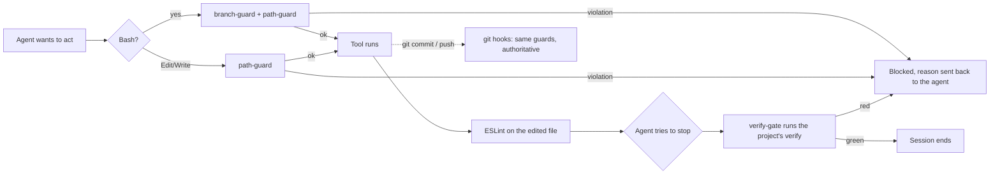

# la-fruteria

A Claude Code marketplace that ships one plugin, `dev-factory`. The plugin makes coding agents check their own work: it blocks commits to protected branches, protects the files that enforce the policy, rejects AI attribution in commits, and does not let a session finish while the project's verify is red.

It has zero dependencies (Node built-ins only) and adds about 50 ms to a tool call.

## Quick path

```bash
claude plugin marketplace add enderdev01/la-fruteria
```

```bash
claude plugin install dev-factory@factory-marketplace
```

Then, in a project under `~/DEV`:

1. Ask Claude to run the `create-verification-skill` skill. It adds `scripts/control.mjs`, the feature map, the git hooks and the branch guard.
2. Type `/dev-factory:trust` so the verify gate and the linter may run that project's code.
3. Work as usual. The guards act on their own.

## How it works

Every guarantee sits at the strongest layer that can hold it. Prose in `AGENTS.md` is the last resort, not the first.



| Layer | Piece | What it guarantees |
|---|---|---|
| Claude Code hooks | `branch-guard`, `path-guard` | An agent's command or edit is checked before it runs |
| Claude Code hooks | `check-file`, `verify-gate` | Lint errors and a red verify come back to the agent in the same turn |
| Git hooks | `pre-commit`, `pre-merge-commit`, `pre-push`, `commit-msg` | The same policy for every agent and every human, even without the plugin |
| Agents | `lemon` delegates to `kiwi`, `fig`, `mango`, `cherry` | Cheap models search and read logs; a separate model verifies with evidence |
| Skills | `verify`, `push-up-the-ladder`, `create-` and `maintain-verification-skill` | A reviewer's correction becomes a test or a lint rule, not one more line of prose |

The Bash checks are best effort (a script or an interpreter can still write); the git hooks are the authoritative layer. Details, scope and the trust model: [plugins/dev-factory/README.md](plugins/dev-factory/README.md).

### The agents

| Agent | Model | Role |
|---|---|---|
| 🍋 `lemon` | Session model | Orchestrator: the main session, delegates on its own |
| 🥝 `kiwi` | Haiku | Scout: read-only codebase search |
| 🫐 `fig` | Haiku | Log reader: reports each test, build and lint failure |
| 🥭 `mango` | Sonnet | Builder: implements one well-specified unit |
| 🍒 `cherry` | Opus | Inspector: independently verifies a change, with evidence |

## Demo

This is real output. `bench` creates a throwaway repo on `main`, then runs each guard exactly as its hook does:

```bash
node scripts/control.mjs bench
```

```text
ok   BLOCK  54ms  branch-guard      git commit -m "quick fix"
       -> Branch policy: git commit blocked: "main" is a protected branch. Work on a feat/, fix/ or hotfix/ branch: git switch -c feat/<name>
ok   BLOCK  52ms  branch-guard      git push origin main
       -> Branch policy: git push blocked: Pushing to protected branch "main" is forbidden. Open a PR from a feat/, fix/ or hotfix/ branch instead.
ok   BLOCK  54ms  branch-guard      git commit --no-verify -m "skip hooks"
       -> Branch policy: --no-verify is forbidden: the git hooks enforce the branch policy.
ok   BLOCK  52ms  branch-guard      git config core.hooksPath /dev/null
       -> Branch policy: Changing core.hooksPath is forbidden: it would disable the branch policy.
ok   allow  55ms  branch-guard      git status
ok   allow  56ms  branch-guard      npm test
ok   BLOCK  43ms  path-guard        rm -rf .githooks
       -> dev-factory: <repo>/.githooks enforces the branch and commit policy. Agents cannot change it: ask the human to edit it.
ok   allow  39ms  path-guard        echo done > notes.txt
ok   BLOCK  39ms  path-guard        Edit .githooks/pre-commit
       -> dev-factory: .githooks/pre-commit enforces the branch and commit policy. Agents cannot change it: ask the human to edit it.
ok   allow  38ms  path-guard        Edit src/app.js
ok   BLOCK  66ms  attribution-guard commit message ending in "Co-Authored-By: Claude <noreply@anthropic.com>"
       -> Commit policy: AI attribution is forbidden in commits, remove this line: "Co-Authored-By: Claude <noreply@anthropic.com>"
ok   allow  66ms  attribution-guard commit message ending in "feat: add login"

median of 20 runs per case, node 26.13.0
```

The agent receives the line after `->` and corrects itself: it creates a `feat/` branch instead of retrying. `bench` exits 1 if any case gets the wrong verdict.

## Benchmarks

Measured on an Apple M1 Pro, Node 26.13.0, median of 20 runs. Reproduce with `node scripts/control.mjs bench` (add `--json` for raw data).

| What | Result |
|---|---|
| `branch-guard` per Bash call | 52–56 ms |
| `path-guard` per Bash, Edit or Write call | 38–43 ms |
| `attribution-guard` per commit | 66 ms |
| Bare `node -e ""` on the same machine | 34 ms |
| Tokens spent by a guard that allows the call | 0 |
| Plugin test suite | 260 tests, 34 suites, 0 failures, 6.0 s |
| Runtime dependencies | 0 |

How to read it:

- Most of the cost is Node starting up (34 ms). The guard logic itself adds 5 to 30 ms.
- A Bash call runs both guards, so it pays for two processes. An Edit pays for one.
- The verify gate costs whatever your project's `verify` costs. With a clean tree it runs once per commit, then skips.

**Not measured here:** whether the agents write better code, or how many tokens delegation to Haiku and Sonnet saves. Those depend on the model and the task, and this repo has no harness for them yet.

## Contributing

Read [AGENTS.md](AGENTS.md), then:

```bash
node scripts/control.mjs doctor
```

```bash
node scripts/control.mjs verify
```

Commit only on `feat/`, `fix/` or `hotfix/` branches; changes reach protected branches through a pull request.
